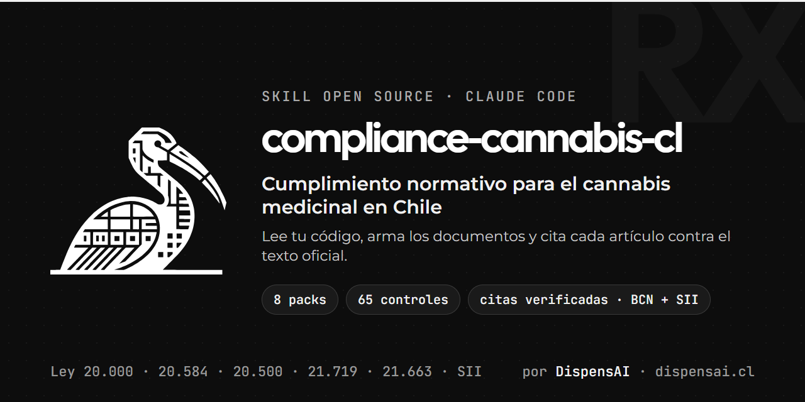

<div align="center">



# compliance-cannabis-cl

### Cumplimiento para trabajar con cannabis medicinal en Chile, desde la terminal

> Mantenida por [DispensAI](https://dispensai.cl). Es la skill con la que validamos el cumplimiento de nuestro
> software, y la abrimos a la comunidad: asociaciones de pacientes, cultivos autorizados, prestadores de salud y
> quien construya software para ellos.

Una skill de [Claude Code](https://claude.ai/code) que lee tu código, arma los documentos de cumplimiento y te
dice, artículo por artículo, qué cumples, qué falta y qué preguntas necesitan criterio jurídico. Cada cita está
comprobada contra el texto oficial (BCN y SII) con un script que puedes volver a correr.

[](LICENSE)


</div>

---

## Por qué

En Chile un paciente puede tener una **receta médica** de cannabis, pero ni el Estado ni el mercado privado le
aseguran el tratamiento. Para cumplir esa receta, los pacientes se organizan en **asociaciones sin fines de lucro**
(Ley 20.500) y cultivan en forma colectiva. Ese modelo toca muchas leyes a la vez:

- la **Ley 20.000** y sus reglamentos (receta, cultivo, entrega, publicidad);
- la **Ley 20.584** (cuándo un registro es ficha clínica y qué obliga);
- el **Código Civil** y la **Ley 20.500** (estatutos, socios, actas, sin lucro);
- el **SII** (cuotas de asociados, IVA, DJ 1945, conservación de respaldos);
- las leyes de **datos personales** (19.628 hoy, 21.719 desde el 1-dic-2026) con datos de salud, que son sensibles;
- la **Ley 21.663** de ciberseguridad, que puede alcanzar al proveedor del software;
- la **Ley 21.595** de delitos económicos.

Ningún documento junta todo eso con las citas exactas. Esta skill lo hace sobre tu repo y deja el resultado
versionado.

## Para quién

| Quién | Qué saca de la skill |
|---|---|
| **OSFL de pacientes** (asociación o corporación) | gobierno asociativo, registro de socios, política de receta, trazabilidad, cuotas frente al SII, datos de salud |
| **Proveedor del software** (SaaS para asociaciones o dispensarios) | qué datos trata y en qué rol, si es servicio esencial de la Ley 21.663, reporte de incidentes, DPA con cada organización |
| **Cultivo autorizado por el SAG** | bitácora de cultivo, cosecha y destrucción (DS 867) |
| **Prestador de salud** (médico, centro) | cuándo su registro es ficha clínica, contenido mínimo del DS 41, 15 años de conservación |

## Qué hace

Corres `/compliance-cannabis-cl` sobre tu repo y:

1. **Pregunta lo básico:** organización, rol en cada flujo de datos, si es OSFL, si cultiva con autorización del
   SAG y si su registro lo escribe un profesional de salud.
2. **Lee el código:** datos personales y de salud, recetas, entregas, cuotas, proveedores y transferencias fuera
   de Chile.
3. **Evalúa 65 controles** con un catálogo que puntúa varias leyes a la vez (un control se evalúa una vez y cuenta
   para todas las que lo exigen).
4. **Resuelve lo que la ley permite resolver** y lo dice con el artículo: si tu registro es ficha clínica (Ley
   20.584 Arts. 3 y 12), quién está obligado por la Ley 21.663 (Art. 4), si la DJ 1945 te aplica (4.000 UF), si
   necesitas DPO o EIPD.
5. **Deja por escrito lo que no se puede resolver sin criterio jurídico**, con las citas a favor y en contra
   (ver abajo).
6. **Arma los documentos** rellenados con tus respuestas y lo encontrado en el código.
7. **Guarda el estado** en `.compliance/` para ver qué mejora o qué se rompe entre corridas.
8. **Construye las remediaciones** en el código si se lo pides (MFA, cifrado, audit log, derechos ARCO,
   retención, monitoreo), con las recetas de `references/build/`.

## Marcos cubiertos

| Pack | Normas | Estado | Cubre | Controles |
|------|--------|--------|-------|-----------|
| `sanitario-cannabis` | Ley 20.000, DS 867, DS 404/405, Decreto 84/2015, Código Sanitario | **ya vigente** | receta (Art. 8 inc. 2), entrega personal, trazabilidad, no combustión, publicidad, autorización SAG | `san-*` (10) |
| `ley-20584` | Derechos del paciente + DS 41/2012 | **ya vigente** | test de ficha clínica, contenido mínimo, acceso, 15 años, portabilidad, consentimiento informado | `pac-*` (9) |
| `ley-20500` | Ley 20.500, Código Civil Título XXXIII, Constitución Art. 19 N° 1, 9 y 15 | **ya vigente** | la OSFL como asociación: fundamento del cultivo colectivo, estatutos, socios, actas, sin lucro | `osfl-*` (8) |
| `tributario` | Código Tributario, DL 825 (IVA), DL 824 (Renta), Res. SII 103/2017 y 94/2023, Oficios SII | **ya vigente** | cuotas de asociados, IVA, comprobante de ingreso, DJ 1945, conservación seis años | `trib-*` (4) |
| `ley-19628` | Protección de la vida privada | **vigente hasta 1-dic-2026** | datos de salud solo con consentimiento escrito, respuesta en dos días hábiles | `t19628-*` (2) |
| `ley-21719` | Protección de Datos Personales | vigencia **1-dic-2026** | consentimiento, derechos ARCO, RAT, DPA, seguridad, brechas, transferencias | `data-*`, `sec-*`, `inc-*` |
| `ley-21663` | Ley Marco de Ciberseguridad | escalonada | quién está obligado (el SaaS puede serlo), reporte al CSIRT en 3 h / 72 h / 15 días | `ciber-*` (3) |
| `ley-21595` | Delitos Económicos (MPD) | **ya vigente** | modelo de prevención, código de ética, matriz de riesgos | `gov-*` |

## Qué resuelve y qué no

**Lo resuelve, con el artículo:**

- **¿Mi registro es ficha clínica?** Solo si lo lleva un prestador por la atención que él dio (Ley 20.584 Arts. 3 y
  12). Si no lo es, la skill pide no llamarlo así en ningún texto, porque el nombre anuncia obligaciones que la
  organización no asume.
- **¿Me obliga la Ley 21.663?** La OSFL, en principio no. El proveedor del software puede caer en "servicios
  digitales y servicios de tecnología de la información gestionados por terceros" (Art. 4): depende de la
  resolución de la Agencia.
- **¿Tengo que presentar la DJ 1945?** Si los ingresos del año superan 4.000 UF (Res. SII 94/2023).
- **¿Cuánto guardo los respaldos de cuotas y gastos?** Al menos seis años (Código Tributario Arts. 17 y 200),
  aunque el socio pida borrar sus datos.

**No lo resuelve; lo deja documentado `[criterio jurídico]`:**

- **¿La entrega a los socios es lícita?** Se cruza con la Ley 20.000 Art. 4 inc. 2 y el DS 404 Art. 5. La skill
  arma el fundamento del modelo (receta → sin provisión pública ni privada → asociación → cultivo colectivo, con la
  Constitución Art. 19 N° 1, 9 y 15) como **argumento con evidencia por eslabón**, no como regla zanjada.
- **¿La cuota del socio es cuota de asociado o venta?** El SII aceptó cuotas variables según lo que recibe cada
  asociado (Oficio 2419/2013), pero en un caso de alimentos donados; el caso del cannabis lo verifica el
  fiscalizador con los hechos.

### La DJ 1945 y las cuotas de los socios

Es común creer que la DJ 1945 justifica los aportes. **No es así**: la DJ 1945 los **informa**. Sus instrucciones
dicen que las OSFL siguen sujetas "al mismo tratamiento tributario que el resto de los contribuyentes". Lo que
sostiene una cuota de asociado es:

1. **DL 824 Art. 17 N° 11:** "No constituye renta: [...] Las cuotas que eroguen los asociados."
2. **Oficio SII 2419/2013:** la cuota puede ser fija o variable, fijada en los estatutos "con carácter de
   uniformidad y generalidad para todos los asociados".
3. **Oficio SII 3616/2002:** no lleva IVA ni factura; basta "un comprobante de ingreso".

El control `trib-aporte-trazable` pide que cada cuota registrada cite la regla de los estatutos que la fija, y
`trib-dj1945` que el software pueda exportar por año los ingresos por tipo y por RUT.

## Quickstart

```bash
# 1. Instalar (la skill es este repo)
git clone <url-de-este-repo> ~/.claude/skills/compliance-cannabis-cl

# 2. Bajar los textos oficiales (BCN y SII), que no se redistribuyen: recetas en sources/FUENTES.md

# 3. Comprobar que todas las citas aparecen en esos textos
python -I scripts/verify_quotes.py

# 4. En Claude Code, dentro del repo a auditar:
/compliance-cannabis-cl
```

## Ejemplo de output

```text
.compliance/
├── state.json        # postura por marco + estado de cada control (con evidencia archivo:línea)
├── RESUMEN.md        # brechas priorizadas + qué resolviste + diff vs la corrida anterior
├── INSTRUCTIVO.md    # guías: derecho ARCO · brecha · fiscalización · calendario
└── docs/
    ├── san-fundamento-modelo-operativo.md  san-politica-receta.md  san-registro-trazabilidad.md
    ├── san-bitacora-sag.md                 (solo con cultivo autorizado)
    ├── pac-clasificacion-registro.md       pac-politica-ficha-clinica.md (solo si es ficha clínica)
    ├── osfl-gobierno-asociativo.md
    ├── 21719-rat.md  21719-politica-privacidad.md  21719-consentimiento.md  21719-canal-derechos.md
    ├── 21719-dpa.md  21719-anexo-transferencias.md  21719-plan-respuesta-brechas.md  21719-eipd.md
    └── 21595-modelo-prevencion-delitos.md  21595-codigo-etica.md  21595-matriz-riesgos.md
```

Cada corrida es un commit: git queda como historial de tu postura.

## Respaldado en fuentes oficiales

- **Textos:** XML de Ley Chile (BCN) y documentos del SII. No se versionan en este repo (repo público, la
  redistribución de la BCN no está confirmada): [`sources/FUENTES.md`](sources/FUENTES.md) trae `idNorma`, URL,
  SHA-256 y el comando para bajarlos a `sources/.cache/`.
- **Verificación:** `python -I scripts/verify_quotes.py` busca cada cita de 20 o más caracteres de los packs y sus
  plantillas en esos textos y falla si alguna no aparece. Correrlo después de editar un pack y cada vez que cambie
  una ley.
- **Marcas:** lo que no se pudo verificar lleva `[verificar contra fuente oficial]`; lo que exige interpretación,
  `[criterio jurídico]`.
- **Los oficios del SII** responden consultas concretas: orientan, pero no obligan al fiscalizador frente a hechos
  distintos.

## Estructura

```text
SKILL.md                          # el motor (multi-pack, se apoya en sources/)
references/
  controls.md                     # catálogo de 65 controles + crosswalk
  output-model.md                 # formato del estado .compliance/
  cuando-acudir-a-abogado.md      # por qué el abogado es opcional
  instructivo-situaciones.md      # guías operativas
  mapa-articulos-21719.md         # artículos de la 21.719 chequeados contra el texto oficial
  build/                          # recetas para construir las remediaciones
packs/
  sanitario-cannabis/             # Ley 20.000, DS 867, DS 404/405, Código Sanitario
  ley-20584/                      # derechos del paciente y ficha clínica (DS 41/2012)
  ley-20500/  tributario/         # la OSFL como asociación; SII
  ley-21719/  ley-19628/          # datos personales: la nueva y la vigente hasta dic-2026
  ley-21663/  ley-21595/          # ciberseguridad; delitos económicos
scripts/
  bcn_article.py                  # lee un artículo del XML oficial de la BCN
  verify_quotes.py                # verifica todas las citas contra BCN y SII
  quote-allowlist.txt             # textos entre comillas que no son citas legales
sources/                          # FUENTES.md + caché local de textos oficiales (git-ignored)
```

## Pendientes conocidos

- Artículos transitorios de la Ley 21.663 (vigencia escalonada): no leídos.
- DS 110/1979 (reglamento de personas jurídicas), citado por el Oficio 2419: vigencia sin verificar.
- Resolución de la Agencia de Ciberseguridad que identifica los servicios esenciales: revisar cuando se publique.

## Roadmap

- [x] Packs `sanitario-cannabis`, `ley-20584`, `ley-20500`, `tributario`, `ley-21663`, `ley-19628`.
- [x] Verificador de citas contra BCN y SII.
- [ ] Completar el mapa de artículos de la 21.719 (transferencias internacionales, MPD/DPO).
- [ ] Mejor detección de cambios entre corridas.
- [ ] Revisión legal opcional de las plantillas (un plus, no un requisito).

## Contribuir

Se agradecen issues y PRs, sobre todo correcciones de citas comprobadas contra el texto oficial (con
`verify_quotes.py` en verde) y packs nuevos. Lee [`CONTRIBUTING.md`](CONTRIBUTING.md).

## Qué no hace

- **No dice si tu modelo de cultivo o entrega es legal.** Documenta las preguntas abiertas con sus citas.
- **No vigila en tiempo real** (DLP, alertas 24/7): prepara el plan de respuesta y puede configurar alertas sobre el
  audit log.
- **No te representa** ante la Agencia, el SII, el ISP o tribunales, ni reemplaza la **supervisión externa anual
  del MPD** (Ley 21.595).

## Aviso

Esto no es asesoría legal: un software no asume tu responsabilidad legal y la decisión final es tuya. En el
cannabis medicinal varias preguntas centrales no tienen respuesta zanjada; la skill las marca como
`[criterio jurídico]` en vez de esconderlas. Para esas, y si te fiscalizan, conviene un abogado. Ver
[`NOTICE.md`](NOTICE.md).

## Licencia

[MIT](LICENSE) © 2026 DispensAI. Los packs de datos personales y delitos económicos nacen de
[compliance-cl](https://github.com/Lelemon-studio/compliance-cl) (MIT © 2026 Lelemon SpA); ver [`NOTICE.md`](NOTICE.md).
